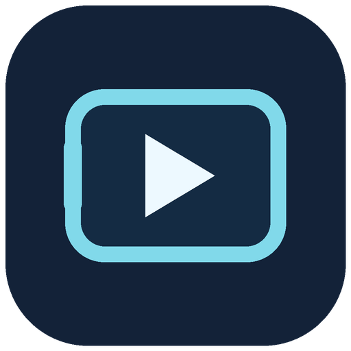
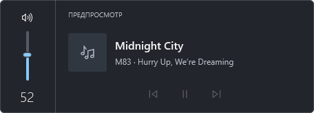
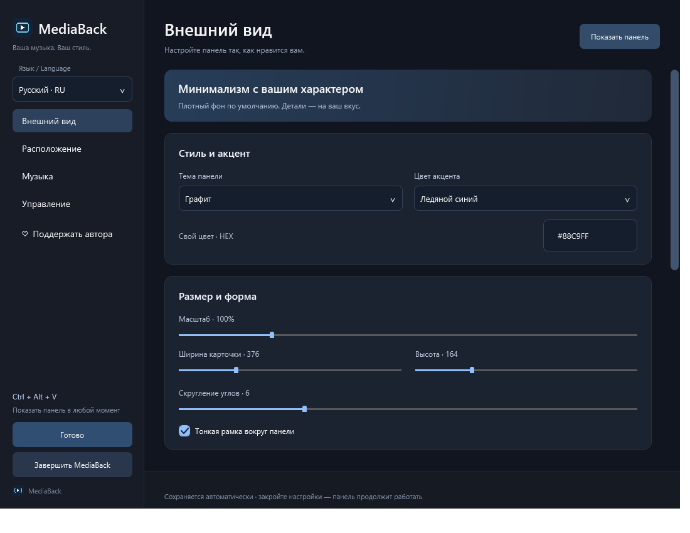
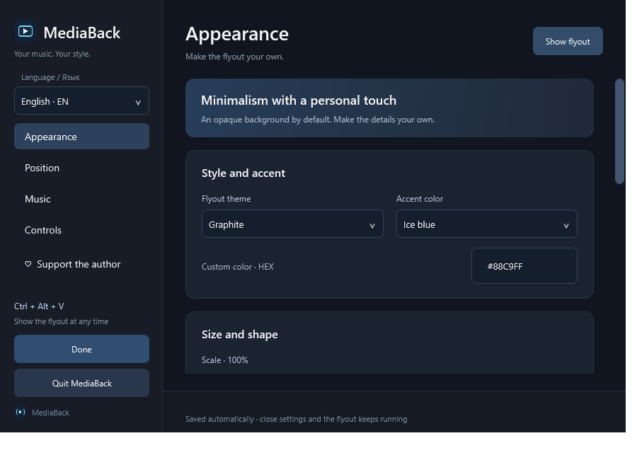

# MediaBack

**Громкость и музыка снова под рукой. / Your volume and music, back within reach.**

Бесплатная панель громкости и музыки в стиле Windows 10 для **Windows 11 x64**. Настройте один раз — панель продолжит работать в фоне после закрытия настроек.

A free Windows 10-style volume and media flyout for **Windows 11 x64**. Set it up once, close the settings, and keep your music controls within reach.

### [↓ Скачать / Download 0.4.2 beta · Windows 11 x64 · MSI](https://github.com/pmewax/MediaBack/releases/download/v0.4.2-beta/MediaBack-Setup.msi)

[Код / Source](source) · [Сборка / Build](README.txt) · [Что нового / Release notes](https://github.com/pmewax/MediaBack/releases/tag/v0.4.2-beta) · [Все выпуски / All releases](https://github.com/pmewax/MediaBack/releases) · [♡ Поддержать / Support](DONATIONS.md) · [Ошибки / Issues](https://github.com/pmewax/MediaBack/issues)

[Русский](#русский) · [English](#english)

## Русский

### Новое в 0.4.2

- **RU / EN:** мгновенная смена языка вверху бокового меню, с сохранением выбора. Переведены настройки, подсказки, трей, кадрирование и диалоги поддержки.
- **Курсор в игре:** стрелка при наведении на панель, если игра скрыла свободный указатель. Для игр с заблокированной мышью добавлен режим **Ctrl + Alt + M**. Панель временно получает фокус; **Esc**, повторное сочетание или щелчок снаружи завершают режим.
- **Плавный индикатор громкости:** короткое сглаживание без задержки изменения звука. При перетаскивании ползунок следует за мышью напрямую. Плавность можно выключить.
- **Аккуратнее настройки:** все пункты бокового меню доступны при минимальном размере окна.

### Возможности

- Трек, исполнитель, обложка и кнопки управления из Windows Media Session.
- Закрепление музыкального источника, чтобы игра не перехватывала управление плеером.
- Показ по клавишам громкости и поддерживаемым аппаратным регуляторам. Ползунок микшера Windows не вызывает панель.
- Положение, монитор, масштаб, темы, акцент, прозрачность, собственный фон с кадрированием и плавное скрытие.
- Свои глобальные сочетания, выключатель всех быстрых команд и каждой команды отдельно.
- Работа в фоне, автозапуск и необязательный значок в трее.
- Название сайта у браузерного источника, когда его удаётся определить; отображение можно отключить.

### Установка и обновление

1. Скачайте **MediaBack-Setup.msi** по кнопке выше. Для установки нужен MSI. Автоматические архивы GitHub **Source code** не являются установщиком; их состав зависит от тега.
2. Запустите MSI. Для обновления с 0.4.1 используйте новый MSI: сохранение настроек проверено.
3. Выберите язык и внешний вид, затем закройте настройки — панель продолжит работать.
4. Клавиша громкости или **Ctrl + Alt + V** показывает обычную панель без переключения активного окна.
5. Для повторной настройки: **Пуск → MediaBack**. Для полной остановки: **Завершить MediaBack** в настройках.

Установка для текущего пользователя: `%LOCALAPPDATA%\Programs\MediaBack`. .NET включён в пакет. MSI добавляет автозапуск при входе в Windows; его можно выключить в приложении или Windows. Настройки сохраняются автоматически. Обновления скачиваются вручную из [Releases](https://github.com/pmewax/MediaBack/releases).

### Если игра скрыла курсор

Если указатель свободно двигается, наведите его на панель. Если игра удерживает мышь, нажмите **Ctrl + Alt + M**, переключите трек и нажмите **Esc**, чтобы вернуться к игре. Сочетания меняются или отключаются в **Управление → Быстрые команды**. Курсор и сглаживание настраиваются в **Управление → Курсор и игры**.

Используйте оконный режим или без рамки. Поведение зависит от игры: режим проверен с тестовым окном со скрытым курсором; прямая проверка в Roblox не проводилась. Эксклюзивный полный экран и защищённые окна могут ограничивать работу панели. Приложение не внедряется в игры.

### Как вернуть стандартную панель Windows 11

**Параметры → Приложения → Установленные приложения → MediaBack → Удалить**, либо **Пуск → MediaBack → Удалить MediaBack**.

Удаление останавливает приложение и убирает его файлы, ярлыки и автозапуск. Системные файлы Windows не заменяются: стандартная обработка клавиш возвращается после завершения MediaBack. Настройки и фоны остаются в `%LOCALAPPDATA%\MediaBack`; при необходимости удалите эту папку отдельно.

### Совместимость, безопасность и приватность

Плеер должен поддерживать **Windows Media Session**: одного воспроизведения звука недостаточно. Совместимость зависит от приложения; название сайта определяется не всегда. Не проверены все гарнитуры, регуляторы, конфигурации мониторов и игры. Это бета-версия.

MSI **не подписан сертификатом издателя**. Windows может показать предупреждение: проверяйте источник и SHA-256 из релиза, не отключайте защиту Windows. 169 автоматических проверок прошли; Microsoft Defender не обнаружил угроз в финальном MSI. Это не заменяет независимый аудит. [Проверки и ограничения](SECURITY.md).

Приложение работает локально, без учётной записи, рекламы, телеметрии и передачи музыки на сервер. Использует Windows Media Session и Core Audio. [Приватность](PRIVACY.md). Программа использует память и процессорное время; нулевая нагрузка не обещается.

### Исходники и проверка

Код версии 0.4.2 доступен для изучения прямо в [source](source). [Инструкция по сборке](README.txt), [результаты проверок](VALIDATION.txt) и [контрольные суммы исходного комплекта](SHA256-SOURCE.txt) находятся в корне репозитория.

Для сборки нужны Windows x64 и .NET SDK 10.0.401 или совместимая версия .NET 10. Из корня репозитория запустите `./build.ps1` в PowerShell. Скрипт собирает приложение и MSI; установка автоматически не запускается.

Код предоставлен для просмотра, локальной сборки и проверки на условиях [LICENSE.txt](LICENSE.txt). Это **source available**, а не open source: права на распространение изменённых сборок не предоставляются. Публикация кода не заменяет независимый аудит; побайтная воспроизводимость релизного EXE не заявляется.

### ♡ Поддержать автора

Все функции бесплатны. Если MediaBack помогает каждый день, можно поддержать развитие добровольным донатом: **[монеты, сети и адреса →](DONATIONS.md)**. Те же адреса и QR доступны в настройках. Спасибо за поддержку, идеи и отзывы!

## English

### What's new in 0.4.2

- **RU / EN:** switch languages instantly at the top of the sidebar; your choice is saved. Settings, tooltips, tray menus, cropping and support dialogs are translated.
- **In-game cursor:** an arrow appears over the flyout when a game hides a freely moving pointer. For games that lock the mouse, **Ctrl + Alt + M** temporarily activates the panel. **Esc**, the same shortcut or an outside click ends interaction mode.
- **Smoother volume indicator:** a short visual transition with immediate audio changes. Direct slider dragging stays responsive. Smoothing can be disabled.
- **Settings layout:** all sidebar entries remain accessible at the minimum window size.

### Features

- Track title, artist, artwork and playback controls through Windows Media Session.
- Pin a music source so another media session does not take over your controls.
- Show the flyout using volume keys and supported hardware controls; the Windows volume mixer does not trigger it.
- Customize position, monitor, scale, theme, accent, opacity, a cropped background image and fade-out.
- Assign global shortcuts, enable or disable each command, or disable all quick commands.
- Run in the background with optional startup and tray icon.
- Display the website name for browser media when it can be identified; this is optional.

### Install or update

1. Download **MediaBack-Setup.msi** using the link above. GitHub's automatic **Source code** archives are not installers; their contents depend on the tag. Use the MSI to install.
2. Run the MSI. Updating from 0.4.1 with existing settings has been tested.
3. Choose **English · EN** at the top of the sidebar and customize the flyout. Closing settings keeps MediaBack running.
4. Press a volume key or **Ctrl + Alt + V** to show the regular flyout without changing the active window.
5. Reopen **Start → MediaBack** to configure it later. Use **Quit MediaBack** in settings to stop it completely.

Installed for the current user in `%LOCALAPPDATA%\Programs\MediaBack`, with .NET included. The MSI enables startup at sign-in; you can disable this in MediaBack or Windows. Settings save automatically. Download updates manually from [Releases](https://github.com/pmewax/MediaBack/releases).

### When a game hides the cursor

If the pointer can move freely, hover over the flyout. If the game locks it, press **Ctrl + Alt + M**, use the media controls, then press **Esc** to return to the game. Change or disable bindings under **Controls → Quick commands**. Cursor and smoothing options are under **Controls → Cursor and games**.

Use windowed or borderless mode. Compatibility depends on the game: interaction mode was tested with a hidden-cursor test window, not directly in Roblox. Exclusive fullscreen and protected windows can restrict the flyout. MediaBack does not inject into games.

### Restore the Windows 11 flyout

Uninstall through **Settings → Apps → Installed apps → MediaBack → Uninstall**, or **Start → MediaBack → Uninstall MediaBack**.

Uninstalling stops the app and removes its program files, shortcuts and startup entry. Windows system files are not replaced; normal volume-key handling returns when MediaBack exits. Your settings and backgrounds remain in `%LOCALAPPDATA%\MediaBack`; remove that folder separately if desired.

### Compatibility, security and privacy

Requires **Windows 11 x64** and a player supporting **Windows Media Session**. Audio playback alone does not provide a controllable session. Website identification is not always possible. Not every headset, hardware dial, monitor configuration or game has been tested. This is a beta release.

The MSI is **not digitally signed by a publisher certificate**. Windows may show a warning. Check the download source and release SHA-256; do not disable Windows protection. 169 automated checks passed and Microsoft Defender found no threats in the final MSI. This is not an independent security audit. [Checks and limitations](SECURITY.md).

MediaBack works locally without an account, ads, telemetry or uploading music. It uses Windows Media Session and Core Audio. [Privacy](PRIVACY.md). It uses memory and CPU time; zero resource usage is not promised.

### Source and verification

Browse the 0.4.2 application code in [source](source). The repository includes [build instructions](README.txt), [verification results](VALIDATION.txt) and [source-package file hashes](SHA256-SOURCE.txt).

Build on Windows x64 with .NET SDK 10.0.401 or a compatible .NET 10 version. Run `./build.ps1` from the repository root in PowerShell. It builds the app and MSI without automatically installing them.

Source is provided for inspection, local builds and verification under [LICENSE.txt](LICENSE.txt). This is **source available**, not open source; permission to redistribute modified builds is not granted. Public source does not replace an independent audit, and the release EXE is not claimed to be reproducible byte for byte.

### ♡ Support the author

All features are free. If MediaBack makes your day a little easier, you can support its development voluntarily: **[coins, networks and addresses →](DONATIONS.md)**. The same addresses and QR codes are available in settings. Thank you for your support, ideas and feedback!

## Автор и права / Author and rights

By [pmewax](https://github.com/pmewax). Бесплатное приложение с исходниками для изучения / freeware with source available for review. Application code, resources and build scripts are available in this repository under the source review terms below.

[Условия / License](LICENSE.txt) · [Сторонние компоненты / Third-party notices](THIRD-PARTY-NOTICES.txt). Неофициальный проект / an unofficial project, not affiliated with Microsoft, Spotify, SoundCloud or other mentioned services. Screenshots use demonstration data.
